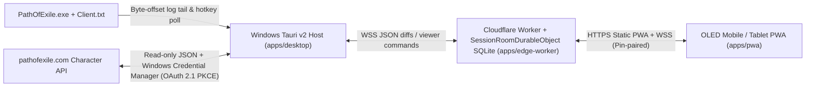

# Exile Relay

[](https://exile-relay.dunhas.com)
[](https://exile-relay.dunhas.com/?demo=1)
[](https://github.com/Srlimao/ExileBuildComppanion/releases/latest)
[](https://github.com/Srlimao/ExileBuildComppanion/actions/workflows/ci.yml)
[](LICENSE)

Real-time, zero-touch **second-screen & local overlay telemetry relay for Path of Exile 1**. A lightweight Windows System Tray app watches your local `Client.txt` log, decodes your Path of Building (PoB) plan, diffs live character telemetry (equipped gear, jewels, Wickerman attachments, resistance overcaps, and allocated passives), and streams context-aware guidance to both a **local dockable PC in-game overlay** and an OLED-first **mobile or tablet PWA** via QR code over a Cloudflare Worker relay.

> **Try it in your browser right now:** open the **[Interactive Demo](https://exile-relay.dunhas.com/?demo=1)** (`?demo=1`) to test Field, Town, Lab, and Passive Tree modes without running Path of Exile.

---

## Player Quick Start (3 Steps)

1. **Launch the Windows PC Host**
   - Download **`ExileRelay.exe`** (portable, zero installation required) or **`ExileRelay-Setup.exe`** (NSIS installer) from **[GitHub Releases](https://github.com/Srlimao/ExileBuildComppanion/releases/latest)**.
   - The app sits in your Windows System Tray, auto-detects Standalone and Steam `Client.txt` paths, and monitors `PathOfExile.exe` / `PathOfExileSteam.exe`.
2. **Load Your Path of Building Plan**
   - Paste a raw PoB export code (works **100% offline** even if `pobb.in` is down at league launch), a `pobb.in` URL, or a local `.xml` file.
   - Optionally select which Passive Specs, Skill Sets, and Item Sets to track, and set your Bandits / Library flags. Your build profile and campaign progress persist locally on your PC.
3. **Use Local Overlay or Pair Your Phone / Tablet**
   - **Local In-Game Overlay:** Press `F7` to show/hide a transparent dockable HUD (`F8` click-through lock, `Ctrl+F1..F4` dock presets) directly over Path of Exile via `BroadcastChannel` (zero cloud latency).
   - **Second Screen (Phone/Tablet):** Scan the QR code shown in the Control Center, or visit **[exile-relay.dunhas.com](https://exile-relay.dunhas.com)** and enter the 6-character **Room ID** and 4-digit **PIN**. Screen Wake-Lock keeps your display awake throughout your run, and the PWA caches assets offline via Workbox.

---

## Key Features During a Campaign Run

- **Auto-Switching Context Modes (`FIELD`, `TOWN`, `LAB`, `TREE`, `STANDBY`):**
  - **`FIELD`**: Zone layout cheat-sheet variants and directional exit compass, branch-aware act checklist (strict area-dominator & prerequisite auto-checking, quest names, and turn-in NPCs), skipped skill-book/trial cleanup backlog, and next-town currency prep tally.
  - **`TOWN`**: `FREE_QUEST_REWARD` vs. `VENDOR_BUY` gem shopping list grouped by NPC, socket/link group verification, live elemental/chaos resistance caps with Act 5 (`-30%`) and Act 10 (`-60%`) Kitava penalties, gear/flask hygiene alerts, and **Auto-Clipboard Vendor Regex** (hit `Ctrl+V` directly in PoE vendor search).
  - **`LAB`**: Daily Labyrinth room graph, Golden Door markers, and Izaro phase notes (supports pasting PoELab JSON).
  - **`TREE`**: Read-only GGG `3.30.0` Passive Skill Tree with bracket-by-bracket diff coloring (allocated, next-bracket targets, carried-over missing nodes, and respec removals), automatic initial framing around your next unallocated passives, persisted camera viewport per profile/bracket, two-finger touch pinch-to-zoom, and **in-game hotkey sync** (pressing `P` inside PoE automatically flips your tablet to `TREE` and back).
  - **`STANDBY`**: Automatically pauses the run timer and shows Act split times when `PathOfExile.exe` closes.
- **Dual Delivery: Local PC In-Game Overlay & QR Second Screen:** Run a transparent dockable overlay directly on your gaming monitor (`F7` show/hide, `F8` click-through lock, `Ctrl+F1..F4` dock presets via zero-latency `BroadcastChannel`) or mirror live telemetry over WSS to your phone/tablet.
- **Per-Mode Customizable Widget Grids:** Drag, reorder, resize (`1x1`, `2x1`, `2x2`), and toggle widgets independently for `FIELD`, `TOWN`, and `LAB` across `Tablet Landscape`, `Tablet Portrait`, and `Phone` breakpoints.
- **Persistent Progress & Two-Step Reset:** Checklist completions (`checkpoints`) and gem acquisitions (`gemSteps`) persist to disk on PC (`saved_campaign_progress.json`) and survive conditional route edits, with 2-click **`Reset Checks`** controls on both PC and Web.
- **League-Launch Resilient:** Automatically falls back to heuristic town soft-tracking if GGG's `character-window` API returns `429` or `5xx` errors, using an exponential-backoff circuit breaker.

---

## Privacy & ToS Safety Guarantee

- **Public profiles work with zero credentials** — only your PoE Account Name (`Name#1234`) and Character Name are needed.
- **Strict Local Keychain Credential Boundary (OAuth 2.1 PKCE):** Optional OAuth 2.1 tokens (`account:profile`, `account:characters` via Authorization Code + PKCE `S256`) and local credentials are stored solely inside **Windows Credential Manager** and used exclusively for direct PC-to-`pathofexile.com` requests. Credentials and OAuth tokens are **never** included in snapshots or sent to Cloudflare; the edge relay actively drops any HTTP/WebSocket payload containing auth tokens or session secrets with HTTP `400` / close code `1008`.
- **Read-Only Telemetry Only:** No game memory reading, DLL injection, packet sniffing, or automated in-game inputs/macros — only byte-offset tailing of `Client.txt`, Win32 foreground key-state polling for `TREE` view toggling, and writing vendor regex text to your clipboard in Town.

---

## Architecture



### Monorepo Layout

| Workspace / Path | Role | Key Stack |
| --- | --- | --- |
| [`packages/game-data`](packages/game-data/package.json) | Static PoE1 route datasets, gems, quests (`quests.json`), zone layouts, and GGG `3.30.0` passive tree metadata | TypeScript source exports |
| [`packages/core`](packages/core/package.json) | PoB decoder & set filter, `#ifdef` route compiler, checkpoint graph, telemetry reducer, passive tree diff, vendor regex, wire protocol | TypeScript, Zod, pako, fast-xml-parser, Vitest |
| [`apps/edge-worker`](apps/edge-worker/package.json) | HTTP/WebSocket edge router + hibernating `SessionRoomDurableObject` with `ctx.storage.sql` SQLite (`room_meta`, `room_snapshot`, `room_layouts`) | Cloudflare Workers, Durable Objects, Vitest |
| [`apps/pwa`](apps/pwa/package.json) | OLED black companion HUD with customizable widget grids, pinch-zoom `TREE` canvas, QR/PIN pairing, and `?demo=1` offline demo | React 19, Tailwind CSS v4, Vite, Workbox PWA |
| [`apps/desktop`](apps/desktop/package.json) | Windows System Tray host, Pairing/PoB Control Center, `Client.txt` tailer, PoE process monitor, Windows Credential Manager keychain, local overlay, and AppData persistence | Tauri v2, Rust, React 19, Tailwind CSS v4 |
| [`scripts`](scripts/verify_max_file_lines.mjs) | Asset/tree ingestion pipelines, Tauri icon generator, and `< 300`-line source file CI gate | Node.js ESM |

For deep technical & UX details, see [poe_companion_hud_architecture_ux_spec.md](poe_companion_hud_architecture_ux_spec.md) and developer guardrails in [AGENTS.md](AGENTS.md).

---

## Local Development

### Prerequisites
- **Node.js 22+** and **`pnpm` 11+** (`pnpm@11.2.2` in [package.json](package.json))
- **Rust stable toolchain** + **Microsoft Edge WebView2** (only required when building or running the Tauri Windows desktop host)

### Common Commands

```bash
# Install workspace dependencies
pnpm install

# Run checks & tests across workspaces
pnpm run check:lines   # Verifies every source/test file in packages/, apps/, and scripts/ is < 300 lines
pnpm test              # Runs Vitest suites in core, edge-worker, and pwa
cargo test --manifest-path apps/desktop/src-tauri/Cargo.toml

# Build core, PWA, and desktop frontend
pnpm run build:all

# Start local development servers
pnpm dev:pwa           # Vite PWA dev server (http://localhost:5173)
pnpm dev:edge          # Builds core + PWA, then runs local Wrangler Worker + Durable Object
pnpm dev:desktop       # Launches Tauri v2 Windows desktop app in dev mode

# Refresh upstream game datasets & GGG passive tree JSON (when game patches)
pnpm run ingest-assets
pnpm run ingest:tree
```

---

## License, Credits & Disclaimer

- **License:** Released under the [MIT License](LICENSE).
- **Third-Party Game Data & Assets:** Built on MIT-licensed routes, icons, and zone layouts from `HeartofPhos/exile-leveling` and `Lailloken/Exile-UI`, plus GGG's official `3.30.0` `grindinggear/skilltree-export` dataset. Full license texts are preserved in [THIRD_PARTY_LICENSES.md](THIRD_PARTY_LICENSES.md).
- **Disclaimer:** This product isn't affiliated with or endorsed by Grinding Gear Games in any way. (Independent MIT open-source community tool.)
