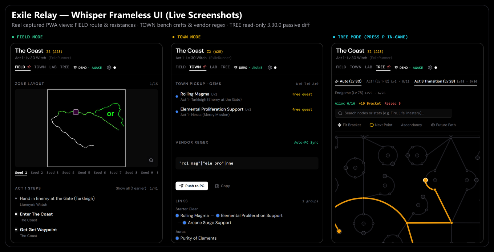
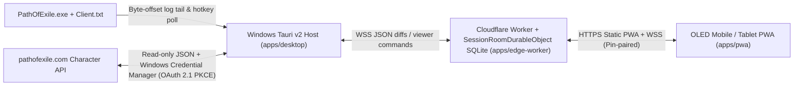

# Exile Relay

[](https://exile-relay.dunhas.com)
[](https://exile-relay.dunhas.com/?demo=1)
[](https://github.com/Srlimao/ExileBuildComppanion/releases/latest)
[](https://github.com/Srlimao/ExileBuildComppanion/actions/workflows/ci.yml)
[](LICENSE)

An **interactive phone & tablet companion (and in-game PC overlay) connected live to your Path of Exile session**.

Upload your **Path of Building (PoB)** once, scan the QR code on your phone or tablet (or press `F7` for the local overlay), and play without ever Alt-Tabbing:
- **Automatic Campaign Guidance:** Follows you from zone to zone automatically, showing your next quest step, waypoint, trial, and zone layout compass.
- **Real-Time Passive Tree & Item Suggestions:** Compares your live character against your PoB to highlight your next passive skill points, missing skill gems, vendor search regex, resistance gaps, and open crafting bench upgrades.
- **Fully Modifiable UI:** Reorder, resize, or hide any widget per screen mode, and customize the look with `OLED`, `Soft Dark`, or `Light` themes and custom accent colors.

> **Try it in your browser right now:** open the **[Interactive Demo](https://exile-relay.dunhas.com/?demo=1)** (`?demo=1`) to explore the Field, Town, Lab, and Passive Tree views—no download or PoE session required.



---

## Quick Start (3 Steps)

1. **Run the Windows App**
   - Download **`ExileRelay.exe`** (portable, ready to run) or **`ExileRelay-Setup.exe`** (installer) from **[GitHub Releases](https://github.com/Srlimao/ExileBuildComppanion/releases/latest)**.
   - It runs quietly in your Windows System Tray and automatically finds your Path of Exile `Client.txt` log.
2. **Import Your Path of Building (PoB)**
   - Paste a PoB code, a `pobb.in` link, or a local `.xml` file.
   - Pick which Passive Trees, Skill Sets, and Item Sets you want to follow. Your build and checklist progress save automatically.
3. **Connect Your Phone, Tablet, or In-Game Overlay**
   - **Phone or Tablet:** Scan the QR code in the app (or open **[exile-relay.dunhas.com](https://exile-relay.dunhas.com)** and enter the Room ID & PIN). Your screen stays awake automatically while you play.
   - **In-Game PC Overlay:** Press `F7` to toggle a transparent, dockable overlay right on your monitor (`F8` locks click-through, `Ctrl+F1..F4` snaps to screen corners).

---

## What It Does While You Play

- **Switches Views Automatically Based on Where You Are:**
  - **In Zones (`FIELD`):** Shows your active Act checklist, zone layout compass, `/passives` missed-book tracker, and currency to save for your next town visit.
  - **In Town (`TOWN`):** Lists which gems to claim for free vs. buy, checks your socket links, tracks elemental & chaos resistances (with Act 5/10 penalties), suggests **Crafting Bench upgrades** for open prefixes/suffixes on your equipped gear, and **auto-copies your vendor search regex** so you just press `Ctrl+V` at the vendor.
  - **In the Labyrinth (`LAB`):** Displays the daily Lab room map, Golden Doors, and Izaro phase notes.
  - **Passive Tree (`TREE`):** Press `P` in-game and your companion automatically flips to a read-only `3.30.0` Passive Tree zoomed onto your next unallocated nodes (color-coded for Allocated, Next Bracket, and Respec).
  - **Between Sessions (`STANDBY`):** Pauses your run timer and summarizes your Act split times when you close the game.
- **Customize Every Screen:** Unlock the layout grid to drag, reorder, resize (`1x1`, `2x1`, `2x2`), or hide widgets separately for `FIELD`, `TOWN`, and `LAB`, and switch between `OLED`, `Soft Dark`, and `Light` themes with 6 PoE accent colors (or any custom hex color).

---

## Privacy & ToS Safety Guarantee

- **Public profiles work with zero credentials** — only your PoE Account Name (`Name#1234`) and Character Name are needed.
- **Strict Local Keychain Credential Boundary (OAuth 2.1 PKCE):** Optional OAuth 2.1 tokens (`account:profile`, `account:characters` via Authorization Code + PKCE `S256`) and local credentials are stored solely inside **Windows Credential Manager** and used exclusively for direct PC-to-`pathofexile.com` requests. Credentials and OAuth tokens are **never** included in snapshots or sent to Cloudflare; the edge relay actively drops any HTTP/WebSocket payload containing auth tokens or session secrets with HTTP `400` / close code `1008`.
- **Read-Only Telemetry Only:** No game memory reading, DLL injection, packet sniffing, or automated in-game inputs/macros — only byte-offset tailing of `Client.txt`, Win32 foreground key-state polling for `TREE` view toggling, and writing vendor regex text to your clipboard in Town.

---

## Architecture



### Monorepo Layout

| Workspace / Path | Role | Key Stack |
| --- | --- | --- |
| [`packages/game-data`](packages/game-data/package.json) | Static PoE1 route datasets, gems, quests (`quests.json`), zone layouts, and GGG `3.30.0` passive tree metadata | TypeScript source exports |
| [`packages/core`](packages/core/package.json) | PoB decoder & set filter, `#ifdef` route compiler, checkpoint graph, telemetry reducer, passive tree diff, vendor regex, wire protocol | TypeScript, Zod, pako, fast-xml-parser, Vitest |
| [`apps/edge-worker`](apps/edge-worker/package.json) | HTTP/WebSocket edge router + hibernating `SessionRoomDurableObject` with `ctx.storage.sql` SQLite (`room_meta`, `room_snapshot`, `room_layouts`) | Cloudflare Workers, Durable Objects, Vitest |
| [`apps/pwa`](apps/pwa/package.json) | OLED black companion HUD with customizable widget grids, pinch-zoom `TREE` canvas, QR/PIN pairing, and `?demo=1` offline demo | React 19, Tailwind CSS v4, Vite, Workbox PWA |
| [`apps/desktop`](apps/desktop/package.json) | Windows System Tray host, Pairing/PoB Control Center, `Client.txt` tailer, PoE process monitor, Windows Credential Manager keychain, local overlay, and AppData persistence | Tauri v2, Rust, React 19, Tailwind CSS v4 |
| [`scripts`](scripts/verify_max_file_lines.mjs) | Asset/tree ingestion pipelines, Tauri icon generator, and `< 300`-line source file CI gate | Node.js ESM |

For deep technical & UX details, see [poe_companion_hud_architecture_ux_spec.md](poe_companion_hud_architecture_ux_spec.md) and developer guardrails in [AGENTS.md](AGENTS.md).

---

## Local Development

### Prerequisites
- **Node.js 22+** and **`pnpm` 11+** (`pnpm@11.2.2` in [package.json](package.json))
- **Rust stable toolchain** + **Microsoft Edge WebView2** (only required when building or running the Tauri Windows desktop host)

### Common Commands

```bash
# Install workspace dependencies
pnpm install

# Run checks & tests across workspaces
pnpm run check:lines   # Verifies every source/test file in packages/, apps/, and scripts/ is < 300 lines
pnpm test              # Runs Vitest suites in core, edge-worker, and pwa
cargo test --manifest-path apps/desktop/src-tauri/Cargo.toml

# Build core, PWA, and desktop frontend
pnpm run build:all

# Start local development servers
pnpm dev:pwa           # Vite PWA dev server (http://localhost:5173)
pnpm dev:edge          # Builds core + PWA, then runs local Wrangler Worker + Durable Object
pnpm dev:desktop       # Launches Tauri v2 Windows desktop app in dev mode

# Refresh upstream game datasets & GGG passive tree JSON (when game patches)
pnpm run ingest-assets
pnpm run ingest:tree
```

---

## License, Credits & Disclaimer

- **License:** Released under the [MIT License](LICENSE).
- **Third-Party Game Data & Assets:** Built on MIT-licensed routes, icons, and zone layouts from `HeartofPhos/exile-leveling` and `Lailloken/Exile-UI`, plus GGG's official `3.30.0` `grindinggear/skilltree-export` dataset. Full license texts are preserved in [THIRD_PARTY_LICENSES.md](THIRD_PARTY_LICENSES.md).
- **Disclaimer:** This product isn't affiliated with or endorsed by Grinding Gear Games in any way. (Independent MIT open-source community tool.)
